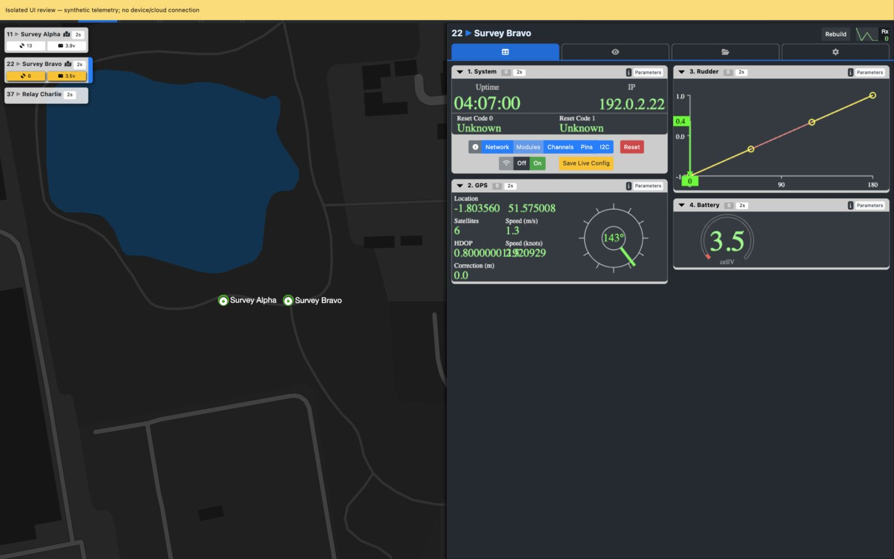
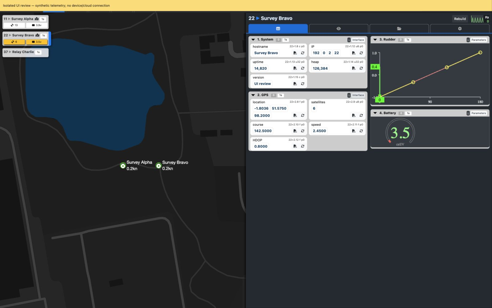

# Legacy Domain workspace UI review

Reviewed: 2026-11-10. Status: research evidence; implementation scope and acceptance plan are not yet agreed.

The purpose of this review is to understand the legacy Node Inspector and floating node list before planning their alignment in the modern Domain detail page. Relevant existing requirements are SYS-01 (typed module parameters), SYS-04 (observation time/freshness), SYS-15 (shared observations/reset), SYS-16 (requested versus observed state) and SYS-17 (mapping/inspection/editing). This note does not change those requirements or the M2 command plan.

## Evidence and limits

- Legacy source: DroneLinkServer `ecb30bd`; modern baseline: DroneLinkClient `927a386`.
- Screenshots use the actual legacy `observer.htm`, `observer.js`, NodeUI, module interfaces and CSS in an isolated loopback preview. Three synthetic nodes, Management/NMEA/Servo/INA219 modules, documentation-range IP addresses and illustrative observations were supplied through Socket.IO.
- Firebase imports were substituted with inert functions in served responses. Outbound socket events had no handlers and could not reach hardware or hosted services. No gateway process, device, staging data, credentials or M2 checkout was changed. The existing public basemap was used.
- The warning banner identifies the synthetic preview and overlaps the legacy top toolbar. No prepared firmware/catalog release was selected; release-dependent controls were unavailable. These screenshots establish layout and interaction evidence, not hardware or cloud acceptance.
- Module values are illustrative, not a firmware correctness fixture. Legacy specialist rendering itself exposes rough formatting, including an unrounded HDOP value. Discovery timers also logged protocol payload-length errors in this disconnected preview; this review does not diagnose or certify that query path.
- Browser checks exercised overlay selection, selected-node title/marker changes, specialist-to-parameter switching, multiple inspector columns at 1600×1000, and returning to a node with its parameter view retained. Drag-reordering, stale time thresholds, server-backed preference persistence and command execution were inspected in source only.

## Screenshots

[Operational overview](legacy-ui/01-overview.jpg): map, top-left node summaries, selected blue edge, warning-coloured widgets and a two-column inspector with specialist views.

[Raw parameter presentation](legacy-ui/02-parameters.jpg): generic typed value cards alongside specialist module views; channel numbers/names/age/reset counts remain visible.

[Writable parameter distinction](legacy-ui/03-writable-parameters.jpg): Rudder parameter cards show writable-value styling, arrays split into individual cells and full addresses/type/priority in the card heading.

## Floating node list

The list is an operational summary for the whole observed fleet. Each compact card combines numeric node address, discovered hostname, map-related icon, elapsed last-heard time and module-provided telemetry widgets. Selected state is a blue right edge. Clicking a card focuses the matching inspector, highlights its map marker and flies to its known location. The inspector opens when needed; first-discovered and remembered nodes can auto-select.

The overlay remains attached to the map, independently of the inspector scroll position. CSS anchors it 8px from the top/left, with compact cards at least 150px wide. Active nodes sort before inactive nodes, then by numeric address. Widgets include battery voltage, satellite count, navigation and other module-dependent summaries; warning/danger colours convey module-specific thresholds.

Legacy last-heard timers turn yellow after 60 seconds and red after 120 seconds. After ten minutes the node fades and its widgets/time/icons and map elements hide. Legacy Firebase-sourced nodes are deactivated independently of age. These are observed legacy rules, not approved cloud connectivity semantics.

Source references (DroneLinkServer):

- `public/observer.htm`: `#nodes` inside `#mapPanel`, separate `#rightPanel`.
- `public/css/observer.css:417–490`: placement, sizing, selection and age styling.
- `public/modules/oui/NodeUI.mjs:75–123,256–264,319–419,710–739,802–809`: card construction, age/activity, focus and widgets.
- `public/observer.js:627–672`: single-node focus, remembered selection, panel opening and ordering.
- `public/modules/oui/interfaces/NMEA.mjs:218–223`, `INA219.mjs:164–171`, `Nav.mjs:304–309`, `MPU6050.mjs:250–255`, `RFM69.mjs:164–169`, `WaterSensor.mjs:127`: summary-widget examples.

## Node Inspector

The inspector is a per-node workspace with a node title/address, Rebuild control, receive sparkline and Management/Visualisation/Configuration/UI Settings tabs. Management is more than a parameter tree: known module types choose purpose-built interfaces, such as GPS/heading, battery gauge and servo calibration graphics. A channel can switch between its specialist interface and generic parameters.

Channels show number/name, reset count and last-heard age. Headers expand/collapse; controls include help and, where applicable, module enable/disable. Channels can be dragged into a custom order and expansion/order preferences have persistence code. The inspector divider can close the panel to zero; opening starts at half the workspace width. Management adds columns at roughly 300px per column, and raw parameter cards form a grid with a 160px minimum.

Generic parameter cards hide system parameter IDs below eight. Remaining values sort numerically and show name, full node/channel/parameter address, type and priority. Arrays use individual cells; integers use locale separators and floats use four decimal places. Address values can resolve to symbolic names, and writable/address values have visual distinctions. Query, CSV export, dragging and editing controls are present in legacy code. The screenshot review did not execute writes.

Source references (DroneLinkServer):

- `public/modules/oui/NodeUI.mjs:145–240,426–436,694–739`: inspector header, panels, preferences and selection.
- `public/observer.js:140–156,585–614`: panel sizing and drag divider.
- `public/modules/oui/panels/Management.mjs:33–105,146–217`: channel sorting, expansion and responsive columns.
- `public/modules/oui/Channel.mjs:67–175,202–347`: channel controls, specialist selection, parameter filtering and sorting.
- `public/css/modules/oui/Channel.css:119–123`: parameter-card grid.
- `public/modules/oui/Parameter.mjs:52–166,200–272,305–423` and `public/css/modules/oui/Parameter.css:13–40,64–74`: formatting, metadata, address resolution, actions and styling.

## Comparison with the modern Client

| Concern | Modern baseline | Gap revealed by legacy |
| --- | --- | --- |
| Multi-node awareness | Dropdown and node buttons inside Inspector | No floating map list or module summary widgets |
| Selection | Inspector and map markers share a selected node callback | Map does not receive current selected ID for selected-marker styling/recentering |
| Inspector content | Node information and generic collapsible channels | No specialist module interfaces or per-node workspace tabs |
| Density | Single vertical channel stack; generic comma-separated values | No multi-column channels or individually formatted typed value cells |
| Working context | Changing nodes remounts Inspector/ChannelList | Expansion context is discarded on node switches |
| Channel summary | Name/ID/type/parameter count/recentness | Reset-count summary and module help are absent |
| Parameter context | Full address/change/name provenance in details dialog | Type/priority/writability/address meaning are less visible in the primary view |
| Freshness | Persisted receipt/change times and last-known observations | Legacy live/inactive rules need reinterpretation, not direct copying |

Modern source references (DroneLinkClient): `src/DomainDetailPage.tsx:29–39,128–136`; `src/components/InspectorPanel.tsx:37–74`; `NodeSelector.tsx:11–43`; `NodeInfo.tsx:35–54`; `ObservedMap.tsx:13–20,79–111`; `ChannelList.tsx:15–46`; `ChannelCard.tsx:24–103`; `ParameterList.tsx:11–29`; `ParameterRow.tsx:8–29`.

## Implications for the next discussion

These are findings to inform planning, not an implementation plan or approved feature list:

1. The floating list needs to support both fast node selection and useful at-a-glance summaries. Merely moving the existing selector over the map would recover only part of its value.
2. Clear selected state should connect list, map and inspector. Automatic map movement and remembered selection deserve an explicit interaction decision.
3. Inspector alignment has two distinct depths: improve the generic channel/parameter presentation, and restore specialist module interfaces. They have substantially different scope.
4. Dense cards, sensible initial expansion and retained per-node context can reduce inspection effort. Useful legacy behaviour can be expressed in the current DroneWright design system without copying its old colours/type scale.
5. Preserve receipt/change/name/source provenance, validation/write-failure warnings, archived/read-only rules and reset permissions. An old observation is not evidence that a node is disconnected; age alone must not erase last-known positions.
6. Parameter editing must align with M2 requested-versus-observed semantics. Rebuild is not automatically equivalent to cloud Reset. Files, configuration, firmware, gamepads, playback and other legacy workbench tabs require their own scope decisions.

Follow-up: the user requested a sliced implementation plan on 2026-11-10. [UI-01](../../../DroneLinkDatastore/docs/planning/ui-01-domain-workspace.md) now records proposed defaults, slice dependencies, requirement-linked acceptance and M2/M4 scope gates in the isolated Datastore planning branch. Review those choices before implementation. No production UI code or milestone completion status changed during this review.

## Floating-list visual remediation review — 2026-11-10

User feedback after UI.1: the functional progress is useful, but the floating list differs substantially from the legacy UI. Reviewed against Client `bf63249` and the saved legacy/modern screenshots. UI.1's functional checks do not establish visual alignment. The key mismatch is structural: legacy is a stack of small independent operational cards; UI.1 is a conventional list inside one large panel.

The captures use different viewport sizes and synthetic data, so this is a source-backed structural comparison, not a pixel-perfect measurement. Legacy CSS uses a 150px minimum card width and 8px map inset; modern CSS uses a 280px bounded container and 12px inset. Keep the accepted modern 14px base and 4px grid when recovering the legacy layout's economy.

| ID | Priority / scope | Difference | Proposed remediation |
| --- | --- | --- | --- |
| R1 | High / visual | One large background/shadow encloses all nodes; unselected rows blend into it. Legacy nodes are distinct cards. | Make the list container visually transparent and give each node its own compact dark tonal surface, restrained shadow and clear inter-card spacing. Keep a bounded scroll viewport for large lists. |
| R2 | High / visual | Fixed 280px width consumes much more map area than legacy's 150px-minimum cards. | Use a compact bounded width driven by the 14px content and usable controls. Evaluate roughly 192–224px as an initial design range, not a settled dimension; accommodate long names with accessible full-name disclosure and constrained wrapping/truncation. Do not obtain density by shrinking the body font or hit targets. |
| R3 | High / visual | A permanent Nodes/count/selected-name header adds chrome and repeats node identity. Legacy starts with the first node. | Remove the permanent desktop header and repeated selection summary. Keep accessible region/count information and a discreet collapse affordance; retain selected context in the collapsed mobile state. |
| R4 | High / visual and formatting | Identity and verbose repeated receipt prose occupy two lines, whereas legacy uses a compact inline header and age badge. | Combine address/name, compact position/action icons and a neutral short receipt-age badge (`4s`, `3m`, `2h`). Preserve exact original Server receipt and its meaning in tooltip/on-demand detail and accessible description. Never imply connectivity or invent a receipt; use an explicit unavailable state. |
| R5 | Rejected by user / visual | Full blue selected-row fill differs from the legacy accent edge. | User explicitly prefers the full blue selection for the dark theme; retain it and the darker card backgrounds. No right-edge accent repair. |
| R6 | Medium / visual | Locate occupies a separate action column outside each row's surface; legacy icons sit within each compact card header. | Put the separate accessible Locate button inside the card header, aligned with identity/age. Keep position availability legible and preserve explicit camera movement, including disabled/no-position behaviour. |
| R7 | Important / deferred UI.4 capability | Legacy cards have satellite/battery/navigation widgets below the header. UI.1 has no operational telemetry row. | Add the verified read-only summary row through UI.4. Plan the card structure to accommodate zero/one/multiple widgets without empty placeholder height. This requires verified mappings/units and missing-data policy, not just CSS; do not silently expand UI.1 or change UI.4 dependencies. |
| R8 | High / acceptance | Existing tests demonstrate selection, cloud lifecycle and responsive operation, but do not test the intended legacy card composition. | Add an explicit visual acceptance gate with matched synthetic fixtures and viewport sizes, alongside the existing functional checks. Review card width/height, map obstruction, node identity/age scanability, card separation and selected-edge treatment before declaring visual alignment. |

Primary source references: Server `public/css/observer.css:417–505` and `public/modules/oui/NodeUI.mjs:75–97`; Client `src/components/NodeSelector.tsx` and `src/components/NodeSelector.css`. Screenshot references: [legacy](legacy-ui/01-overview.jpg), [UI.1 desktop](ui-01/desktop.png), [UI.1 mobile minimum](ui-01/mobile-minimum.png).

Keep the intentional cloud-safe differences: numeric ordering; last-known observations/positions retained regardless of age; neutral receipt-age display; explicit Locate rather than automatic camera movement; source/provenance access; Server-owned permissions; and the minimum-height mobile selection dialog. Legacy age alarms/disappearance are not visual remediation. There is no comparable legacy mobile capture, so the modern mobile adaptation should be judged on usability rather than unsupported claims of mobile parity.

Superseding user direction: implement R1–R4 and R6; retain full blue selection and darker node-card backgrounds, explicitly excluding the R5 right-edge proposal. Widgets remain UI.4 with a planning note only. UI.1-R now implements the authorised visual repair; the original R1–R6 recommendation is superseded by this selection. Broader matched-fixture/overall user visual acceptance remains part of R8/UI.7. Do not change the Inspector, M2 controls, telemetry contracts or widget mappings as part of the visual repair. UI.2–UI.7 sequencing remains subject to the owning plan.

Visual acceptance fixtures should include identical three-node data with a selected/unselected node and a node without a position; short/long/missing names; fresh/old/missing receipts; and a long list. Later widget acceptance adds zero/one/multiple/missing readings. Compare at a shared desktop viewport, then verify 390px mobile, the minimum map panel, keyboard/focus/Locate, scroll clearance, map-error fallback and unchanged provenance/permissions. Record current and proposed screenshots together so the visual outcome is directly reviewable.

UI.1-R implementation: transparent outer list, 224px bounded width, independent dark single-line cards, no permanent desktop header, integrated Locate and short neutral receipt badges with full accessible Server receipt times. Blue selection fills each selected card including its action area. The mobile context/dialog remains. No widget row or placeholder height is implemented.
